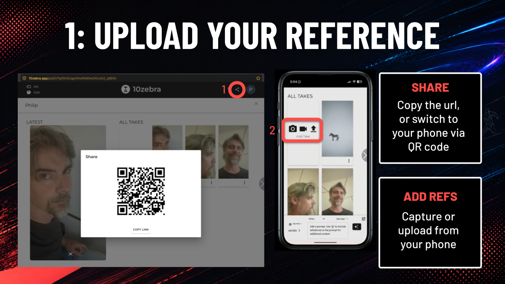
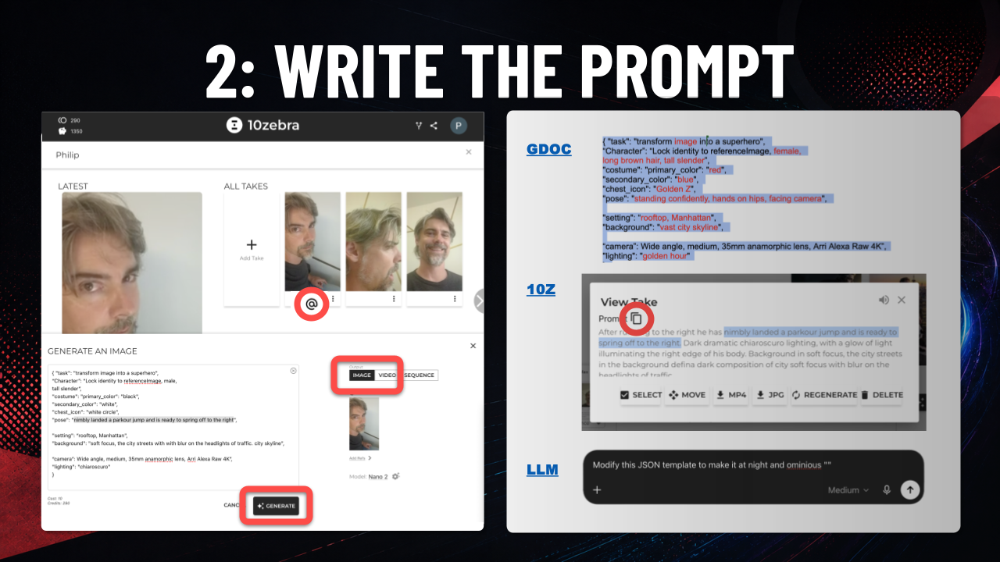
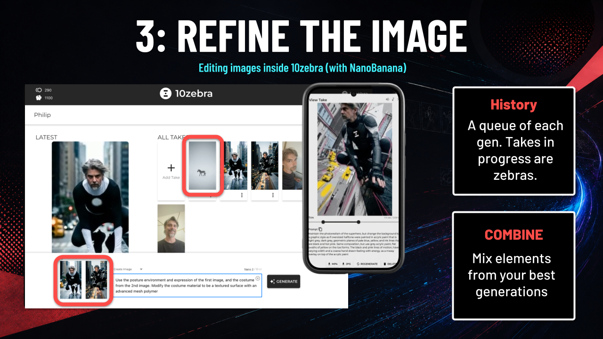
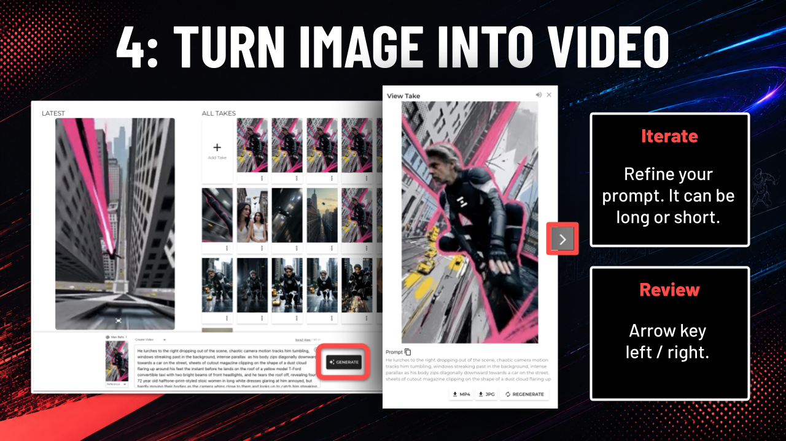
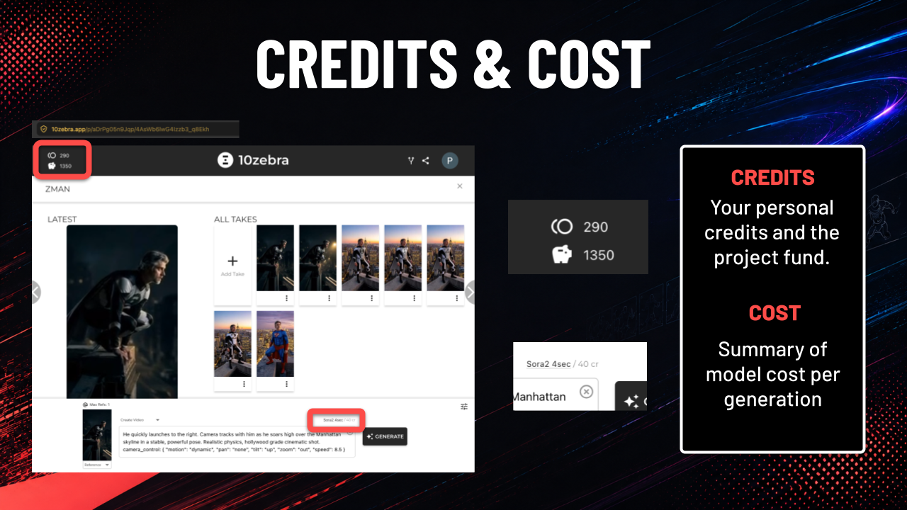

Want to get up to  speed on character creation and video generation? This tutorial is beginer friendly. From image generation to video generation.

We put it together with Robbie Norris and Jon Merlin for an in person at The One Club for Creativity.

At One Clubs AI video 101, the goal was to help you turn yourself into a superhero, and fly around an imaginary scene. We included cinematic approaches, because knowledge of realism works for many applications. Tho personal its not really my own jam - I like to change the style away from realism.

<iframe class="w-full h-full" src="//cdn.embedly.com/widgets/media.html?url=https%3A%2F%2Fwww.instagram.com%2Freel%2FDbMcmkqvi7g%2F%3Futm_source%3Dig_web_copy_link%26igsh%3DMzRlODBiNWFlZA%3D%3D&amp;type=text%2Fhtml&amp;schema=instagram&amp;display_name=Instagram&amp;src=https%3A%2F%2Fwww.instagram.com%2Freel%2FDbMcmkqvi7g%2Fembed%2F%3Fcr%3D1%26v%3D14" frameborder="0" allowfullscreen></iframe>

You can find the presentation [here](https://docs.google.com/presentation/d/17TI9xlXfJ7_4ypRb5JS6_SuGOacQlbVjslPAwAt3UMk/edit?slide=id.g3f58a166942_0_13#slide=id.g3f58a166942_0_13).

And I'll walk you though the process below, step by step, with links.

You need an image of yourself to start a transform. From the browser window click the share icon (1) in the upper right to show the QR code for the specific page you are working on. Scan it with your phone to capture references of yourself (or a location, or pose, or object, etc). From a technical perspective you can work with any image. Using your own likeness requires the least amount of consent or risk of takedown.

Side note: we recommend using paid APIs to protect your privacy. (All models on 10zebra are paid, and none of the outside model providers run through freemium services) While you may supplement your projects with freemium tools and CPP programs outside of 10zebra, (e.g. by uploading those assets into your project), the terms of these systems are beyond our scope and so we can not provide the same clean chain of title reports for those.

Its common to have a "2nd window" for creating. A scratchpad for your prompt before you commit to it. It might be a google document, like the one from Robbie Norris's class, with examples of tested and vetted JSON prompts. It might be another shot in 10zebra project, where you discovered a great sentence to pin down a visual effect. You can copy that prompt, and modify it for your current needs. Sometimes you may want to use an LLM to create a new detailed JSON prompt.

Iteration is the antidote to slop. Be intentional.

If you are building a keyframe for subsequent animation, here are two tips. One: If there is a character that is going to move, capture them in a frozen moment, with the intention of movement (not just standing there idly). Two: (sometimes an opposing goal), If you are going to work a multi shot sequence from an image, try to pack as much information into a core reference: all character and all objects and a relevant location. Then a multishot generation can pull from subsets of that reference. You can also handle this with multiple independent references,  that can be slower and more effortful (say you want to adjust the lighting on all characters)- a strong scene reference can go a long way, and be versatile.

When you have entered your prompt in 10zebra, confirm you are generating a video, and that its the model you want. Our initial defaults strike a balance for quality and cost. We update with all the major model releases. For example: Grok is more cost efficient and Veo tends to be more expensive. At the time of writing this  Sora2 has the highest cost / quality and SeeDance is top performing. Typically you may a just a few words to improve a generation.

