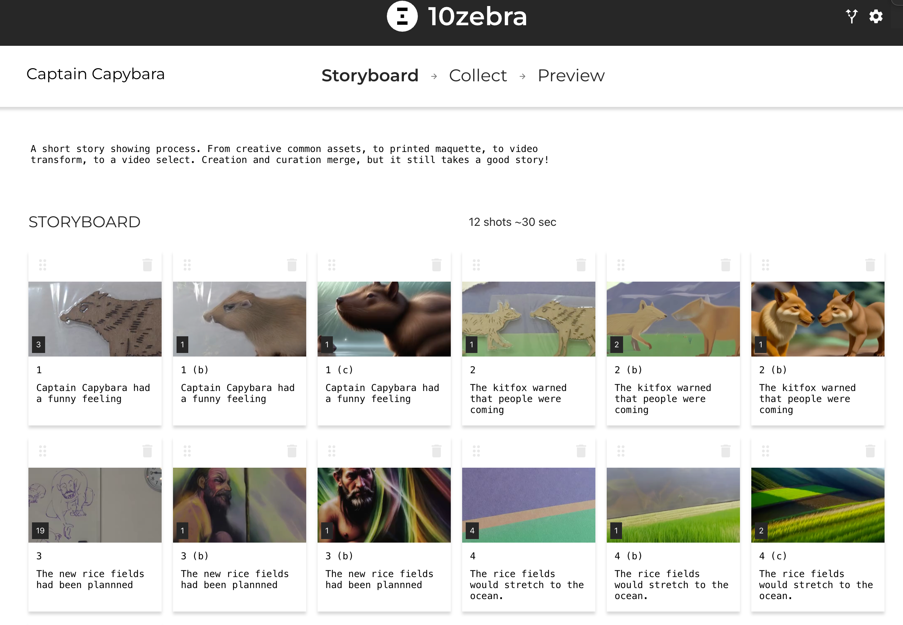

In a digital media class, I watched as a high school teacher organized supplies to teach the fundamentals of visual narrative. It was a short class, geared on teaching stop motion video. But all the ingredient were there. Settings, characters, animation, dialog, pacing.

I could not help but wonder how these same fundamentals will play out in an AI enabled world. What if we still start with craft, the physical manipulable reality, to define our compositions, and tweak our designs. And what if this becomes the starting point for animation, that is richer and extended with advanced tools.

This is the reality that our next generation of creators will live in.

I think that very shortly, anyone can conjure up anything. To me, this mean that *process* - the tools we useexpress ourselves, will grow in importance. If an expert and a novice can make the same thing by saying "make me a dramatic video about dinosaurs in the closet" then the "how," the backstory becomes more interesting.

This mini story "Captain capybara and the kit fox" blends traditional creative tools for storyboarding with a new collaborative ai workflow.

Each shot is shown three times, showing the advances in the creative storyboarding process.

<iframe class="w-full h-full" src="https://www.youtube.com/embed/pjN4hUoUXJ4" title="YouTube video player" frameborder="0" allow="accelerometer; autoplay; clipboard-write; encrypted-media; gyroscope; picture-in-picture; web-share" allowfullscreen></iframe>

Here are the project files:

[https://10zebra.app/p/2m6vBVSwxd5Q](https://10zebra.app/p/2m6vBVSwxd5Q)

<iframe class="w-full h-full" src="https://10zebra.app/p/2m6vBVSwxd5Q" frameborder="0" allowfullscreen></iframe>

CC by 10zebra. (That means you can fork it, and change it, but please keep the "CC by 10zebra" in the project files and if/when you post). A link to this blog is appreciated.
