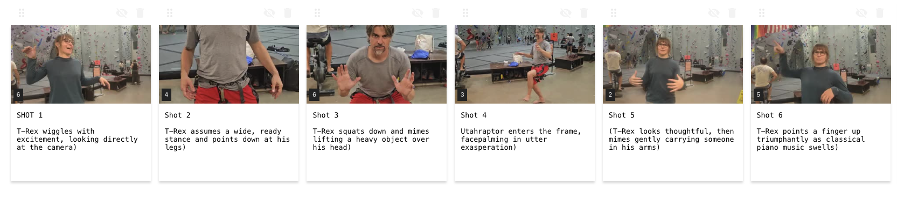
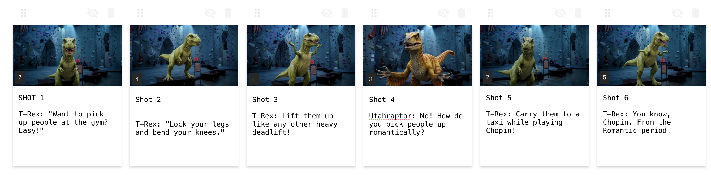
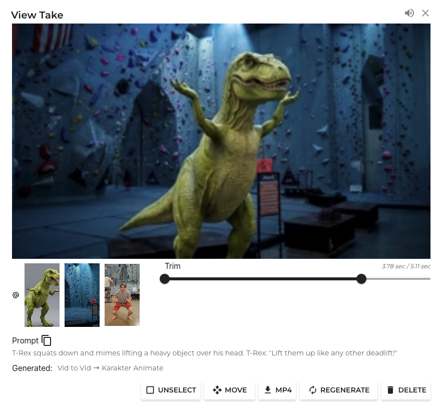
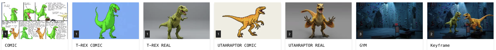

Ah, the genius of pairing images with the spoken work. There are so many good ideas in comic form.

A gem from Ryan North - via [qwantz.com](https://www.qwantz.com/index.php?comic=4497)

Naturally, the evening after I saw this, when I was at the gym,  I convinced my climbing partner we had to make this into a video. First the video, then I'll break down the process.

<iframe class="w-full h-full" src="https://www.youtube.com/embed/zaSVEJj6rr8" title="YouTube video player" frameborder="0" allow="accelerometer; autoplay; clipboard-write; encrypted-media; gyroscope; picture-in-picture; web-share" allowfullscreen></iframe>

A note on credit: I tend to cite my references like an academic. I think this works for educational content. If you were planning some long adventure (like turning you favorite comic into a movie), get them on board early. If you don't make money, its probably good exposure when you give them credit. If you do make money try to work something fair upfront.

Here is the process:

1. Commit to the number of scenes. We used 6.

2. Make sure you can deliver the lines. The current cap is 12 seconds for technical reasons, which is about 20 words. But we are mere mortals and don't remember our lines. So reducing each line to 8 words makes it much more "enjoyable" to act out. Clearly, this is where you deviate from your souce material allot, so if you wanted to be accurate word for words, you might split a long line in two and then switch the camera angle between the two. How might you do this?

Extract the words from this image as a scriptand then:

Rewrite this script so that each line is no longer than 8 words.  While reformating, preserve the overall sentiment and characters, and punchline. 3. Use this new script to set up a 10zebra project. Here is what ours looked like after performance capture.

4. Get the look of each of your characters defined. In this case we want a character that is related to the source comic, but a different style and a (slightly different pose).

5 Choose your background. Here is the prompt we used.

Remove all people. Make the background gym more Cinematicly lit. Blue color grade. And here is a deep link into the project where we processed the background:

https://10zebra.app/p/HnjDpzTQkQ2h/BDj-EzkjPik3EuzUHXHjb

Performances for all six shots.

After generating.

A single generation contains the character reference, the location reference, and a video. Note that the reference is used "As a Video" which allows the video-to video workflows to be active. Without specifying the default workflow is often "Mini" but you could set it to the excact one we used "Karakter Animate" If you want to copy the prompt you can pull it [directlly from 10zebra](https://10zebra.app/p/HnjDpzTQkQ2h/wKGH4E6xdjZYK0vwNAFYV) with one-click. Here it is as well: *T-Rex squats down and mimes lifting a heavy object over his head. T-Rex: "Lift them up like any other deadlift!"*

And after the generation is complete, you can trim it in place:

Here are the side-by-side performances and the generations.

It helps to know how much went into this: this is one of two acted takes and about 1-2 generations. This was completed in about a focused 90 minutes. Time and iteration improves quality (along with newer models, tasteful curation, good prompt writing. etc). For the "look of it" the most important part was character creation. For the functionality the most important part was pipeline design which is not included inn the total time,. But now that it works, you can use the pipeline for free, as long as you pay for the credits of the underlying models.

I hope you dont take this time estimate of "what the pace of production sholud be for me" and therefore what you expect your creative team to work at. That is the pace the pipeline can handle. Its fast. But more intention makes it better. Here are three examples of why you want to pay creative people to make your work better. 1) lighting. This scene has mediocre lighitng. You could control lights in the first capture, or at the references, or at AI post. AT the first reference it probably the wisest for effcieincy. 2) direction: if you know what you are going for then guiding your actors performances can pay off in spaced. Similarly, get your actors more context so that they can get into the right frame of mind. 3) curation. variations of perfromance takes and references create many options. Don't look at everything. you break the budget. Use your intuition and explore in the parts that matter and stand to improve. lBut the point is: if you slow down and do the normal creative treatment that a story deserves, you can do better that this (e.g. the first thing out of the can). Good standard practices are to give yourself four generations per shot.

My top advice for you is to spend more time on your references and less time curating the video gens beyond the best of 4. What do I mean by that? In the example project these images define the provenencce between the core idea and the used references. SO more time spent on references, keyframes and locations will pay off, esp. for longer productions

Core project references

Hopefully you have a better understanding of hybrid production - even though you don't "see the human performances" they are crucial for defining the media that you ultimately create. If you act out a comic, let us know on the socials!
