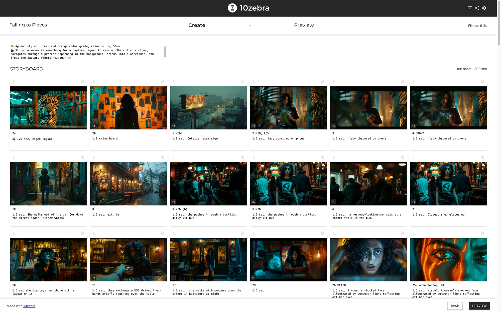
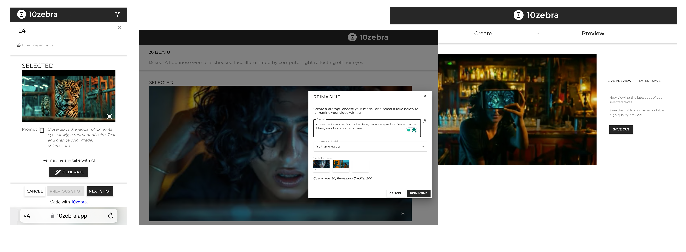
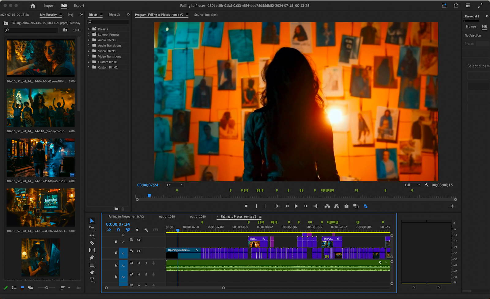
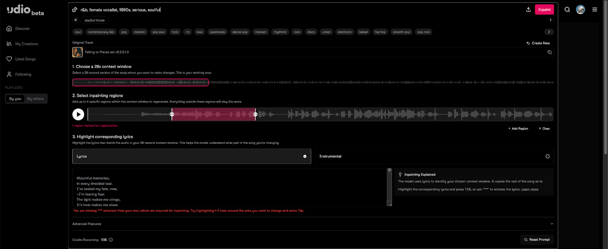
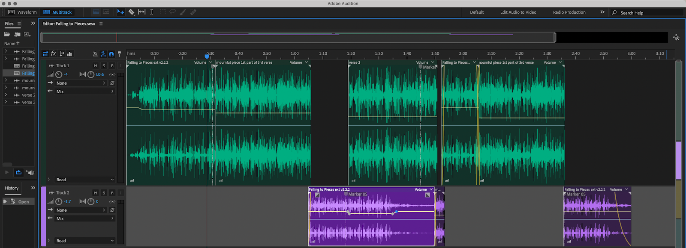
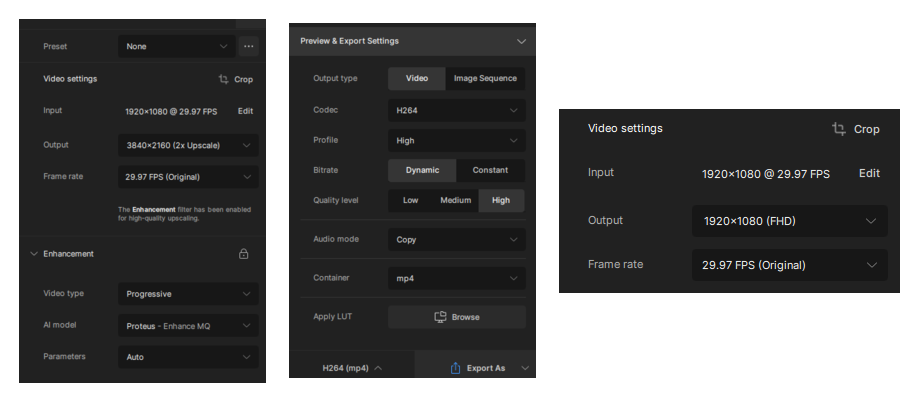

"Falling to Pieces" is our latest project created for the Odyssey AI Video Competition, which closed its submission window on July 16th. When the competition popped up, we jumped at the chance to push 10zebra to its limits and see what we could cook up in just a week. This competition brings together global creators to explore the possibilities of AI in filmmaking. We leveraged a mix of AI audio, visual effects, and 10zebra's all-in-one AI Video app to develop this project. In this blog, we will explore our creative process, the challenges we faced, and the tools we used.

<iframe class="w-full h-full" src="https://www.youtube.com/embed/5WJ0zv4-2cM" title="YouTube video player" frameborder="0" allow="accelerometer; autoplay; clipboard-write; encrypted-media; gyroscope; picture-in-picture; web-share" allowfullscreen></iframe>

Follow along as we take you behind the scenes of "Falling to Pieces," showing the potential of AI in video production.

## Odyssey AI Video Competition

The Odyssey AI Video Competition is organized by Civitai, ElevenLabs, ThinkDiffusion, and Realdreams, with sponsorship from companies like Morph Studio, LensGo, and Domo AI. The competition aims to unite creators and push the boundaries of AI-driven content creation. It includes categories like 3D animation, music videos, and behind-the-scenes footage, offering prizes and industry recognition for standout entries. For more information, visit the[Odyssey AI Video Competition website](https://www.projectodyssey.ai).

## Inspiration for the AI Video Project

Together, the team worked out the story, with Joshua Logan and Philip Meier driving the visual style and AI generation. Helene Federici handled audio and post-production. A key motivation for Philip was to test-drive the recent upgrade to the 10zebra AI video storyboard interface, developed with Rich Rudzinski, 10zebra's lead platform developer. The upgrade introduced a coherent image-to-video workflow for teams.

## AI Video Production Details

The production of "Falling to Pieces" utilized 10zebra's AI video interface, integrating advanced models offering text, image, and video-to-video capabilities. The initial storyboard was automated using 10zebra's auto-storyboard feature. Images were generated with MidJourney and then dragged and dropped into the storyboard for AI video generation.

Checkout [The Complete Guide to Getting Started with 10zebra](http://www.10zebra.com/blog/getting-started-with-ai-video-editing)

### 10zebra’s AI Video Storyboard for “Falling to Pieces”

Using images from Midjourney, “Falling to Pieces” was produced entirely with Haiper.ai's image-to-video technology accessible within 10zebra's all-in-one AI video app. Phil was working almost entirely on 10zebras mobile web app which acts just like an app on your phone.

### AI Video Post-Production Using Adobe CC Apps

### Falling to Pieces Audio-Production in Udio

### Falling to Pieces Post-Production Audio in Audition

### AI Video Upscaling in TopazLabs

Joshua led the upscaling process using TopazLabs. The project was processed for the highest resolution output for Youtube, and the smaller image is the output settings for the contest 1920x10 (FHD), which is full high-definition.

The team collaborated in the 10zebra Discord server for image generation. Post-production was completed using After Effects and Premiere, with Topaz used to upscale the final export. The entire audio production took one day, while video production spanned five days.

👯 [Join 10zebra Discord Server](https://discord.gg/7PCt4Xqw7k)

A private viewing party was held on Discord before submitting the project. Although the timeline was short and the product isn't perfect, the result showcases 10zebra’s rapid development and collaborative features. Phil said that the platform's performance, which synchonized over 500 video assets in realtime in a private collaborative worflow across timezones was sucessful. Phil said, "Everytime we do this, we learn so much about the needs of a creative teams for rapid AI video production."

Working on a tight timeline really pushed us to get creative with AI-assisted video making. We stumbled onto some awesome new ways to use the AI models in the 10zebra platform. All these 'aha' moments are shaping our next moves, setting us up to build even slicker tools for creators from all walks of life.

Check back here for pictures and videos of the behind-the-scenes making of "Falling to Pieces."

👯 [Join 10zebra Discord Server](https://discord.gg/7PCt4Xqw7k)

📼 [10zebra YouTube Channel](https://www.youtube.com/channel/UCrd5JLiRdCW0Yc5D2jn0eEw)

💼 Let’s connect on [LinkedIn](https://www.linkedin.com/company/90422726)

✖️Follow [10zebra on X](https://twitter.com/10zebra_app)(formerly Twitter)
