## Plan Your Story

Every great video begins with a straightforward narrative. Start by brainstorming the message or story you want to tell. This step helps guide the creative process by bringing your vision into focus and ensuring your story remains focused as you work through your project using **10zebra**.

Projects between **1-3 minutes** are the most compatible with 10zebra’s **storyboarding** and **video exporting** features, which are covered in detail below. If your project is longer than 3 minutes, you’ll want to break it up into 1-3 minute storyboards. It’s important to consider these parameters as you plan your story.

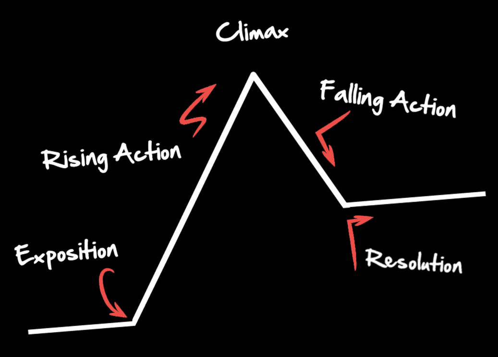

## Start a New Project

Visit[**10zebra.com**](http://10zebra.com/) and click the “**Login to Create**” button if you are a new user registering for the first time. If you are a returning user, navigate to the [**10zebra**.**app**](http://www.10zebra.app)****using the **Login button**at the top of the webpage. Once logged in, you can **start a new storyboard** by clicking the button.

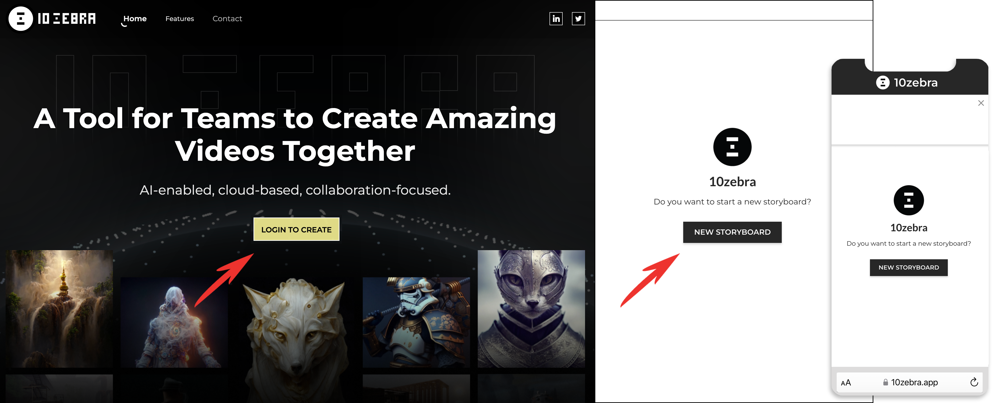

#### 📲 10z Mobile Web App

If you’re on the go, you can use **10zebra’s** mobile web app to create engaging content wherever inspiration strikes.

#### 💡PRO TIP: Bookmark the App

**Pin the app to your browser** or **save the mobile web app to your home screen**, so it’s easy to jump back into your creative workflow anytime.

## Storyboard Your Project

Once you are inside the 10zebra app, you will see it’s a simple interface with a few key features.

- You can **edit the storyboard title**in the upper left corner.
- You can also **add a description** at the top. This is a great place to communicate global style prompts to project collaborators, and you can even share links and other project information here.
- Across the top, you can access the two project views—**create** and **preview**. The app opens in the **create view**, where you can storyboard and open shots to add media and generate AI video.
- The storyboard is made up of **shots**, and there is an option to **add a new shot** at the end.

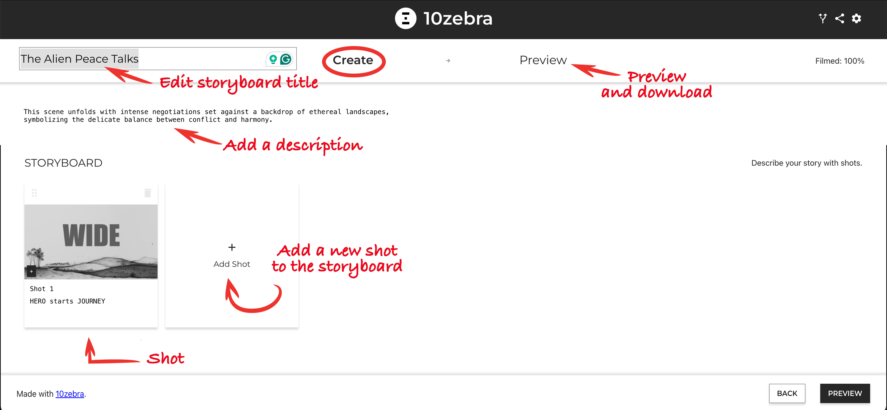

Each shot has a place to add a **title** and a **description**. On the top right of each shot is a **delete** icon, and on the top left is a place to **grab and drag** the shot into a different slot, making it really easy to map out the perfect narrative. You can even see the **number of takes** in each shot in a little box—takes are covered in the next section.

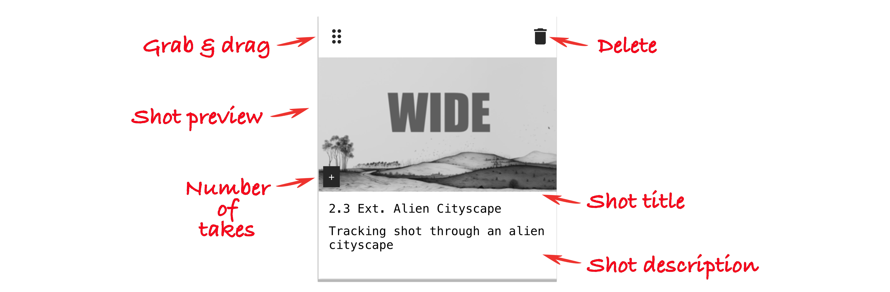

#### 💡PRO TIP: Search your Storyboard

Use the **find** **command** (CMD + F) to easily navigate your storyboard. It will identify both words and storyboard numbers in both the title and description of your shots.

## Add Content to Your Project

When you click on a shot, you open up the **shot editor** where you can **add a take** by adding media—either **images** or **videos**. You can **upload** the files or **drag & drop** them onto the empty take.

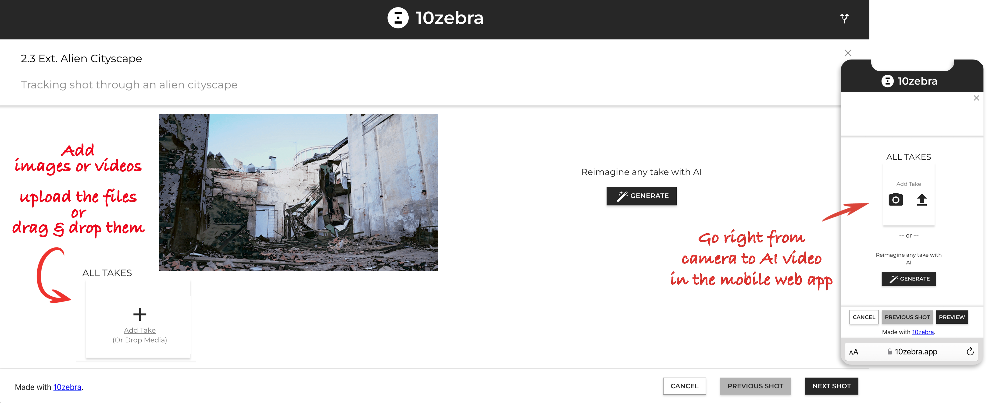

#### 📲 10z Mobile Web App

On **10zebra’s** mobile web app, you can record right from your device’s camera into the app’s shot editor.

#### ℹ️ FYI

When you **add an image**, a light zoom effect, also known as a **Ken Burns effect**, is automatically added so that the still image becomes a moving video, giving the AI something to work with.

#### 💡PRO TIP: Think in shots

AI video generation is most effective with content between **4-8 seconds.**You should aim to establish a visual beat every 2-3 seconds. This may mean generating 4-5 seconds and trimming to the relevant moment. Alternately, use a "text to sequence" method and describe multiple shots in a row (like 3-5 sequential events) often including their durations.

## Import a Project Using AI Video Auto-Storyboard

Do you already have a short inspirational video? Import your**1-3 minute video** into an existing project by looking in the upper right corner menu to access the “Auto Storyboard” feature. Paste your YouTube URL link into the space provided, and **10zebra** will **automatically storyboard** the content as scene boundaries or enforce a maximum of 4-second clips.

Auto-storyboard is a useful feature for music video workflows. Look out for examples of different workflows on [www.10zebra.com/blog](http://www.10zebra.com/blog).

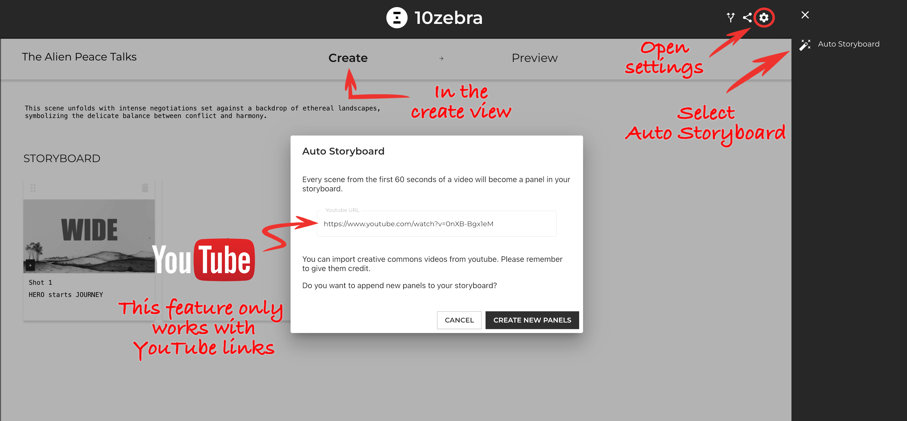

## Invite Your Team to Collaborate

**10zebra** makes collaboration easy. Send a project URL to your team members, enabling them to join from anywhere. This feature supports seamless teamwork, allowing for real-time collaboration and feedback.

To **share your project**, click the share icon in the upper right corner. You can copy the **project URL** or save a **QR code**.

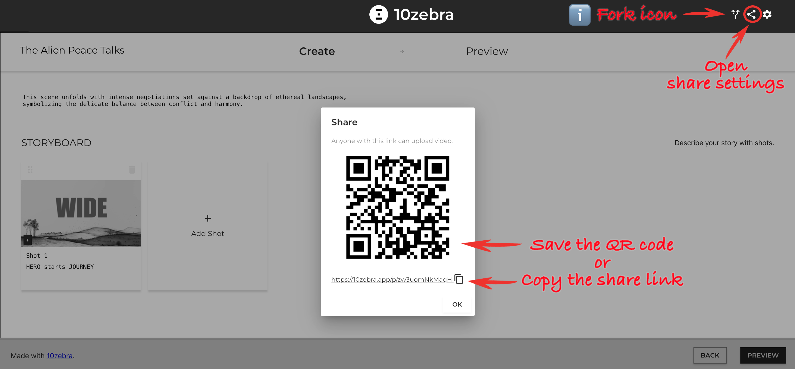

#### ℹ️ FYI

When you **share your project**, collaborators will have **access to features**based on your selection in your share dialog. Notably, you can eenble or disable genertion. you may also create a password on your project.

#### 💡PRO TIP: Fork Your Project

If you want to make a copy for yourself, or allow other team members to make an independent copy of your project, **fork the project** by simply clicking the fork icon next to the share icon.

## How to use AI Video-to-Video or Vid2Vid Models

10zebra’s unique **video-to-video** feature is an effective way to instruct AI with more than just text-based prompts. By uploading an inspirational video, You can communicate certain details more easily. 10zebra’s AI often gets inspiration from the reference video’s **palette**, **camera movement**, and general **composition**. It would be challenging to effectively communicate this spatial detail using text alone.

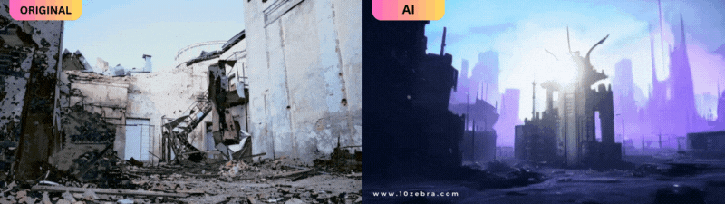

Once you have uploaded content to your storyboard, you can use the video-to-video feature. **Click** **Generate** to open the AI options. **Select the video-to-video** **option** in the dropdown menu. **Select the take** you want AI to use at the bottom. Lastly, at the top, **add a text-based description** in the box to tell AI how you want the video to transform. When you are ready, **click** **reimagine**.

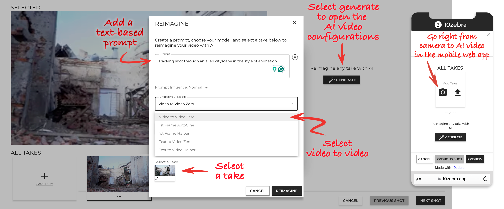

#### 📲 10z Mobile Web App

On **10zebra’s** mobile web app, you can record right from your device’s camera into the app’s shot editor.

## Use Text-based AI Prompts

Whether you use the video-to-video feature or not, you'll want to use text to communicate your vision to **10zebra's AI**. Describe the **subject**, **environment**, and the **style** you want. Experiment with different prompt modifiers to fine-tune the **visuals**, and include **narrative**details like **motivations** and **plot points**. This will help you achieve the perfect aesthetic and emotional impact of your video.

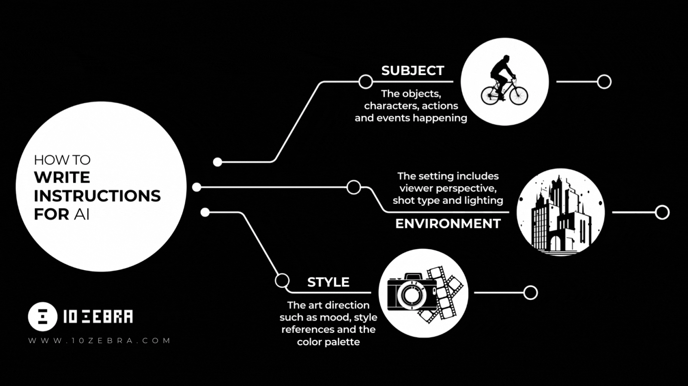

#### 💡PRO TIP: Try Reordering Your Prompt

When writing a creative prompt for AI, the first part of the prompt will be given more emphasis by the AI,  so **reordering the prompt**can lead to meaningful variations, giving you more creative control.

## Set the AI Prompt Influence

Adjust the influence of your prompts by **moving the slider from subtle to strong** to see varying degrees of AI integration in your video. This allows for more control over the creative output, ensuring it aligns with your vision.

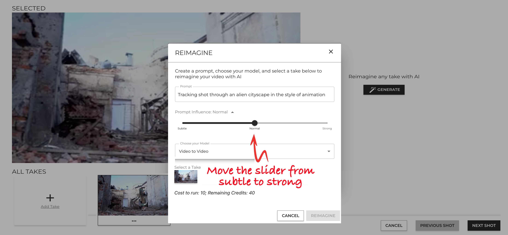

## Select Your AI Video Takes

Once you have storyboarded your project, and after you have generated AI video content, you may have several takes in each shot. You will want to **select your desired take** for each shot before previewing and exporting your project.

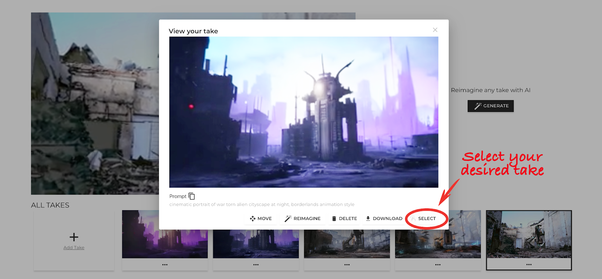

#### ℹ️ FYI

In addition to selecting a take, you can **move a take** to a new shot, **delete** the take, or **download** an MP4 of the individual take.

## Preview Your AI Video

Review the assembled clips in the **preview window** to see how your video is shaping up. This is an important step in the editing process, allowing you to make necessary adjustments before finalizing.

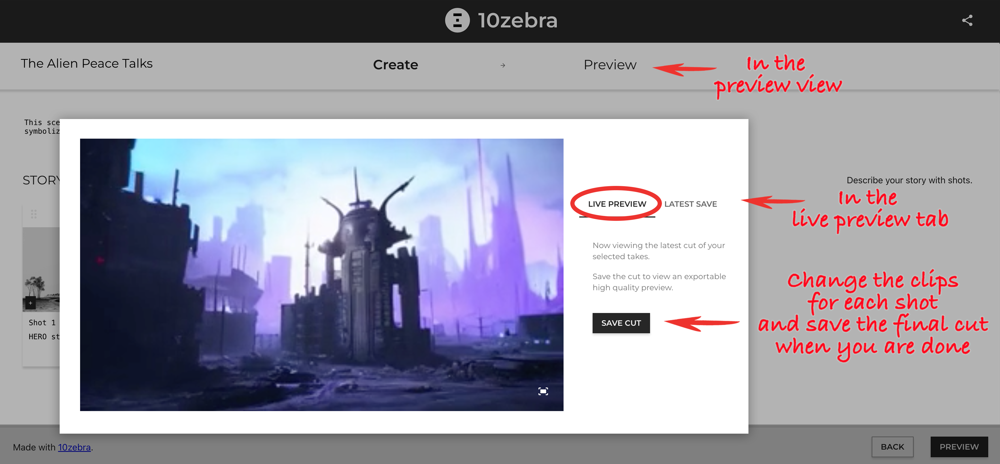

## Download Your AI Video

Once you’re satisfied with your selected clips and sequence, select the **latest save tab**and **download your AI video**. If you would rather have the individual clips, click **export archive** to download a zip file of the clips.

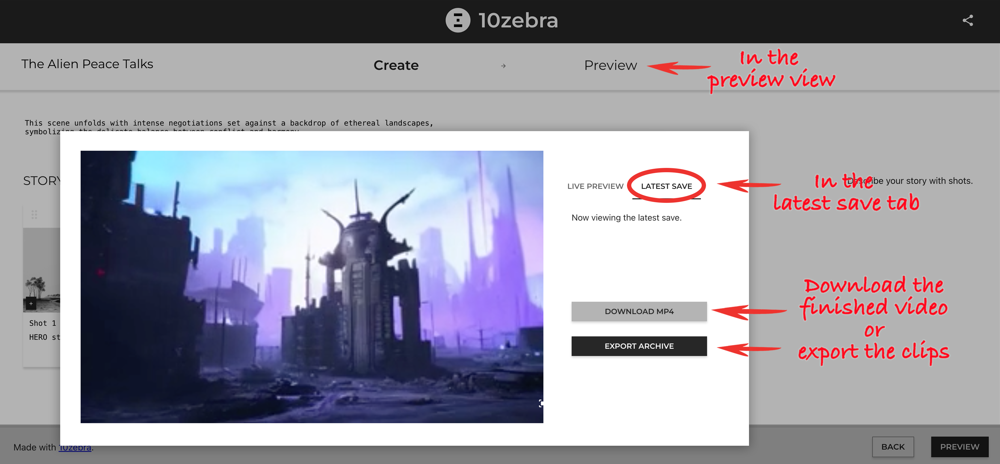

## Share Your AI Video

Now that your project is complete, **share your AI video using #10zebra**. Showcase your AI video2video transformations on social media, connecting with other creative professionals, and don't forget to use **#10zebra** so we can share it, too!

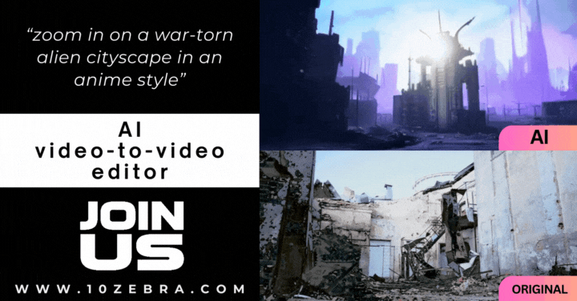

