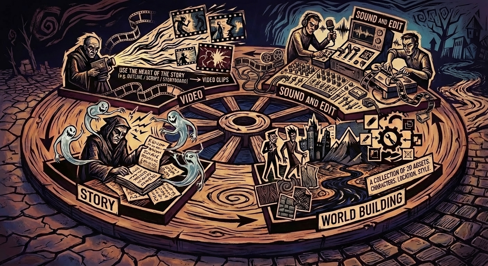
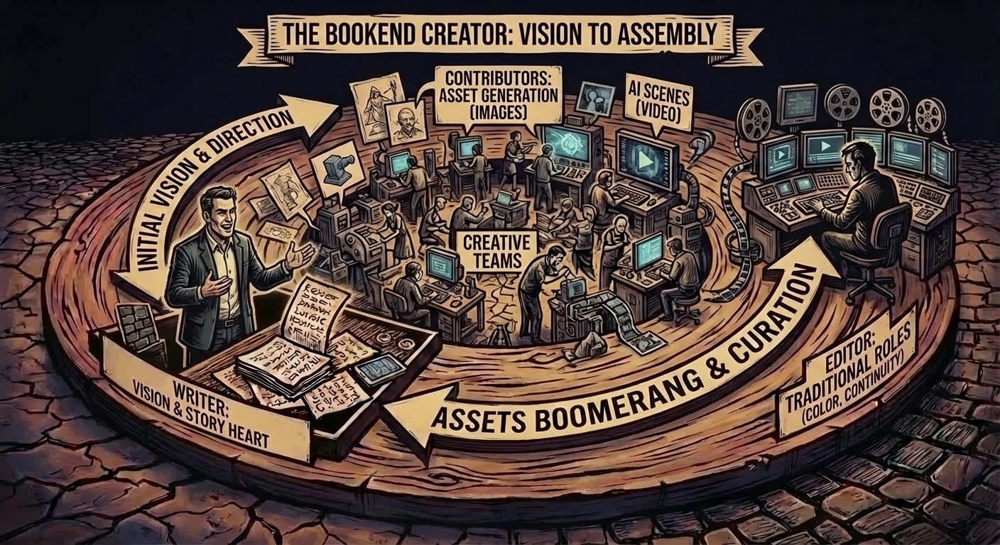

## Henry's Junkyard King cuts a unique style

The Pink Edge leaves space for scenes with emotion. Yes, Seadance also powers a fight scene, but everything around it is built up: Artie's character, his motivations, his emotional response, and even a way to sneak in "solving problems by thinking."

<iframe class="w-full h-full" src="https://www.youtube.com/embed/T45hEBQpL0Y" title="YouTube video player" frameborder="0" allow="accelerometer; autoplay; clipboard-write; encrypted-media; gyroscope; picture-in-picture; web-share" allowfullscreen></iframe>

In his own words:

> The project is inspired by Arthurian legends, but set in a strange 80s-style world where science, mythology and old technology collide. The idea is to tell stories where solving problems with science feels heroic again, something I grew up with watching shows like MacGyver, when being smart was cool.

How do we scale this up? Henry is fantastic, but I don't think one human plus agents is the best way to go. (While possible, its actually kinda lonely). Instead I think you need a small team with the right division of responsibility, encouragement and push back.

### Looking at the main stages for nimble genAI production:

1. Story. Likely 1 person with agents. Notes.

2. World building. For now: a collection of 2D assets. Characters, location, style.

3. Video: Use the heart of the story (e.g. outline / script / storyboard) --> video clips

4. Sound and edit.

When one person keeps it all in their head, they can make more changes on the fly. Can we keep that nimbleness, and allow for specialization, collaboration, and review points?

### TEAM OF TWO

A two person team could split at 1/2 --> 3/4. That means that the early stage the visual creators (a writer / director role) is creating and getting feedback and criticism from their collaborator. And then at a later stage, this flips, and the temporal creator does the heaving, while the initial person provides feedback and notes. This dynamic has the strength that the person giving feedback understands how their own work intersects with the responsibility of the other person holding the baton.

### BOOKEND CREATOR

The writer is the editor. They carry the heart of the story. A crew of contributors may be involved in asset generation (images) and ai scenes (video), but they are all building to the reality of the storyteller. Their initial vision is the guide, but the reality is their (human leadership direction) and precise curation is the where the "interface" between minds lives. This is where the hard choices are made. It also enables traditional roles to fit in when team and budget allow (e.g. color grading, visual continuity edits) In the bookend mode, the assets boomerang back to the creator who assembles the edit. Often this is the key to letting the reigns go for other people to contribute - knowing there is some creative control to maintain the essence of the story at the end.

### THE BIGGEST VARIABLE

Sometimes sound work becomes a whole side chain, and the workflow question is whether to do sound "after" or "alongside" or "before." Any one else agree that *sound* is actually the biggest opportunity for how to improve narrative work in AI videos?

Teamwork is more than production efficiency. What it feels like to do your best work, has everyone in their element. Let's help each other climb even higher!
