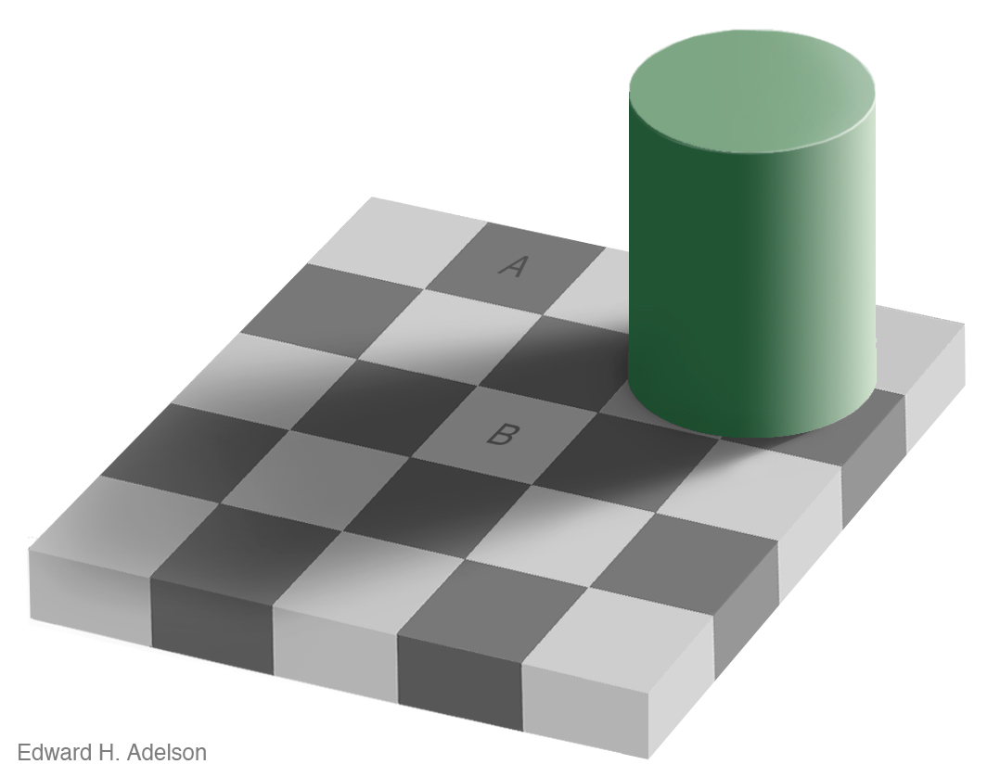
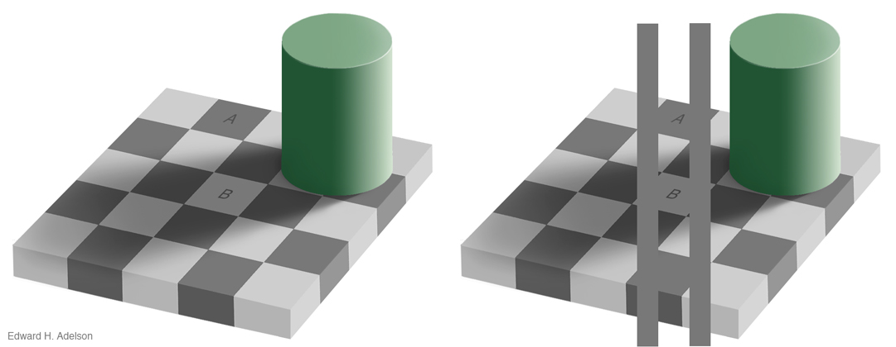
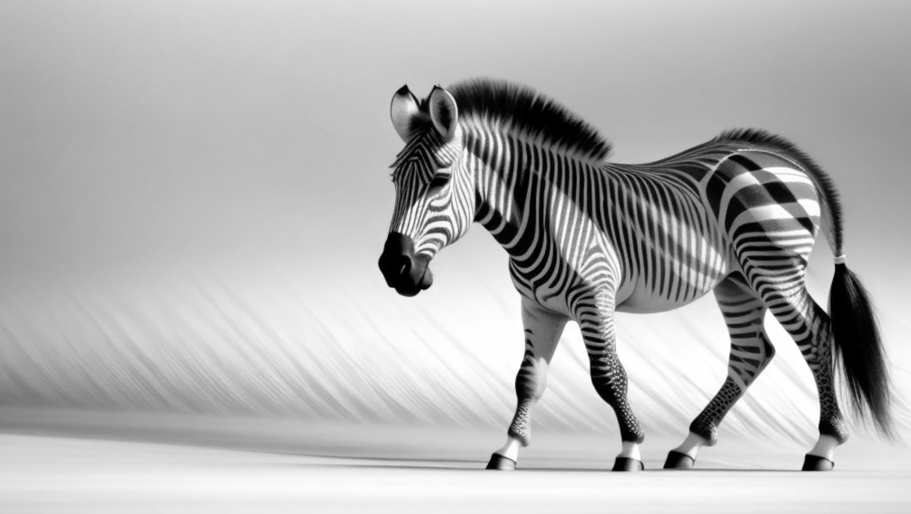
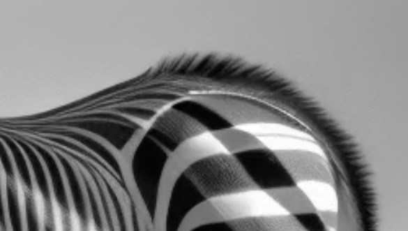

What makes something look bright or dark?

You might think that the amount of light coming from a region is what makes something look bright or dark. You would be wrong. It's so much more complicated. And fascinating.

Ted Adelson made this image to show you how two patches with the same RGB pixel values can "look" so different.

The squares with A and B look different colors to us. 

So what is going on? Context matters. We interpret the shadow. We infer the lighting. We estimate the albedo. Albedo is a fancy word the corresponds to the fraction of light reflected by light. It tends to be used by people who study objects in sky or computer graphics. I think of it as what the paint absorbs in a painting. When you shine a white light on a colorful painting, all that pigment is "removing" a portion of the light, and letting the other part bounce off and hit your eyeball. With gray scale, it's even simpler.

So how does this apply to the image. Let's say patch A and B both return a billion photons per millisecond per patch. Thats the same. But if there was more light landing on A, then only a smaller fraction is reflected. Hence it looks dark.

The Perceptual Science Group at MIT offers this proof and [more](https://persci.mit.edu/gallery/checkershadow/proof). 

Naturally, I had to think of the checker-shadow illusion when this shadow-stripped zebra visited my genAI artistic explorations. It's also similar to some other illusions that exploit the ambiguous relationship of the meaning of light changes at "x" junctions. (If you are interested in that, Marr's book on Vision is great. Here is a [teaser](https://www.contrib.andrew.cmu.edu/~kk3n/80-300/marr2.pdf)) So the zebra image has all the same ingredients: Patterned black and white albedo, and patterned light. To top it off, the light is moving (but I am not showing that here).

An image from a video I created yesterday, all with genAI on 10zebra. 

The patterened light and patterned albedo is similar to the checkershadoow illusion.

Does the AI system have a model of reality enough to "know" how light works? Did it get it right? Not quite. Edge statistics influence that output that don't belong in a luminance boundary. Some edges change their type as they extend across space(e.g. an illumination edge, vs. paint edge, vs occlusion) But the generative models, only by working on patches hierarchically, get a lot of the statistic right. Notably these system are also biased system trying to make things that humans find pretty, and that changes something about contrast. But is also captures something about light and motion, esp the parts we like.

I added the bar to show how the white stripe in shadow  is close to the dark stripe in full light.

Cool. So that just happened. The synthetic checkers on the zebra,

I didn't "try to make this illusion." My prompt was "**profile of a zebra walking in an empty white field"**first using one of our new Flux-based systems. And the I reran the result with "Autocine" to get an infinite animated loop.

As we pack more data into these generative model, more and more subtle statistics of the world will be trapped in those model weights.

Crazy.

When I worked with Ted Adelson at MIT I had a weird job. I did research on perceptual illusions made in Flash. But I also maintained the lab's website. That may sound a bit boring, but if you are an art / tech geek like me, it was the bees knees, b/c Ted has one of the coolest websites around. If I could should the "then me" the kind of new magic tech we are brewing, I would be even more stoked.

Now, in this modern world of generative ai, everything I learned about perception feels even more relevant. If the pixels themselves are real, then nothing is an illusion. But if you believe the false hood they portray, everything is an illusion.
