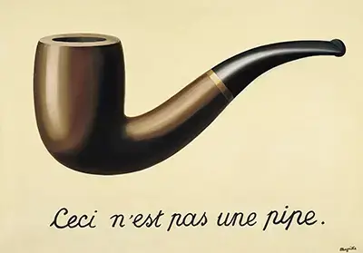
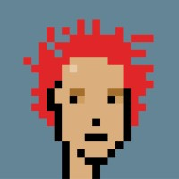
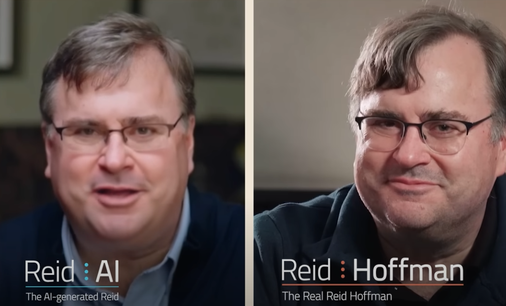

Rene Magritte clearly indicates that his painting of a pipe, is NOT a pipe.

&quot;The Treachery of Images&quot; (1929)

In ou*r* future, will our identity follow our physical likeness?  Or for some of us, will it be the hash of a pixelated punk icon with wild red hair?

On linked in this cryptopunk is Edwards visual self representation. 

This avatar also has read hair, a different age and different vibe. Made in a demonstration at AI on the Lot. 

"AI on the lot" is an annual conference between Hollywood and the AI tech community.**Joanna Popper** moderated a discussion about how "Simulation and AI Agents" provide the potential for a new medium of storytelling and entertainment. Every speaker in that talk was used as the starting point of an AI process to create avatar animations.

<iframe class="w-full h-full" src="https://www.youtube.com/embed/ABzwvKrtJIc" title="YouTube video player" frameborder="0" allow="accelerometer; autoplay; clipboard-write; encrypted-media; gyroscope; picture-in-picture; web-share" allowfullscreen></iframe>

**David Slade**, the director Blackmirror: Bandersnatch shared his fascination and panic about generating images and videos with AI.  As an artist and AI founder I feel both. David reflected on the loss of expert knowledge when working alone with AI tools, without the dynamic interaction between actors.  And also, the loneliness. He is right on.

**Parth Patel**, who works with **Reid Hoffman**, made the point that designing an AI agent is akin to "Character Design."

Screen shot of Reid conversing with his digital twin. 

Alternate visual aesthetic curated with open source diffusion models. 

Animated avatar made in minutes from a quick cell phone clip.

**Shuying Luo**, showed how a minecraft AI agent might be used to educate and assist in a virtual world.

The animated avatars in this post are shared in the context of this event.  Please do not use them out of context. Thank you.

**How it was made:**During their presentations, I zoomed in with my cell phone to frame a short video clip of each speaker.  Using 10zebra's web app, this information was the provided to a collection of AI models in the cloud, and within minutes, short looping animations were created.

These fast social avatars are new and experimental.  Something only possible within the past month. They have challenges. People tend to end up younger.  Or switch ethnicity.  The movement can be chaotic.

But the lack of accuracy is made up with flexibility and speed.  An entire customized process completes in two minutes, and drops right back into your cell phone.  The end result feels more like a "character" or "mask."  Ready to be a part of an AI storyboard or music video.
