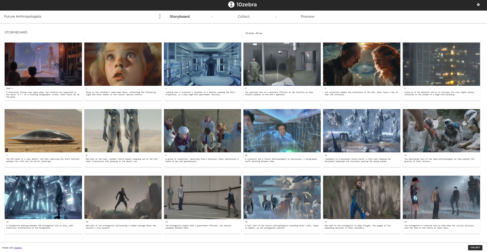
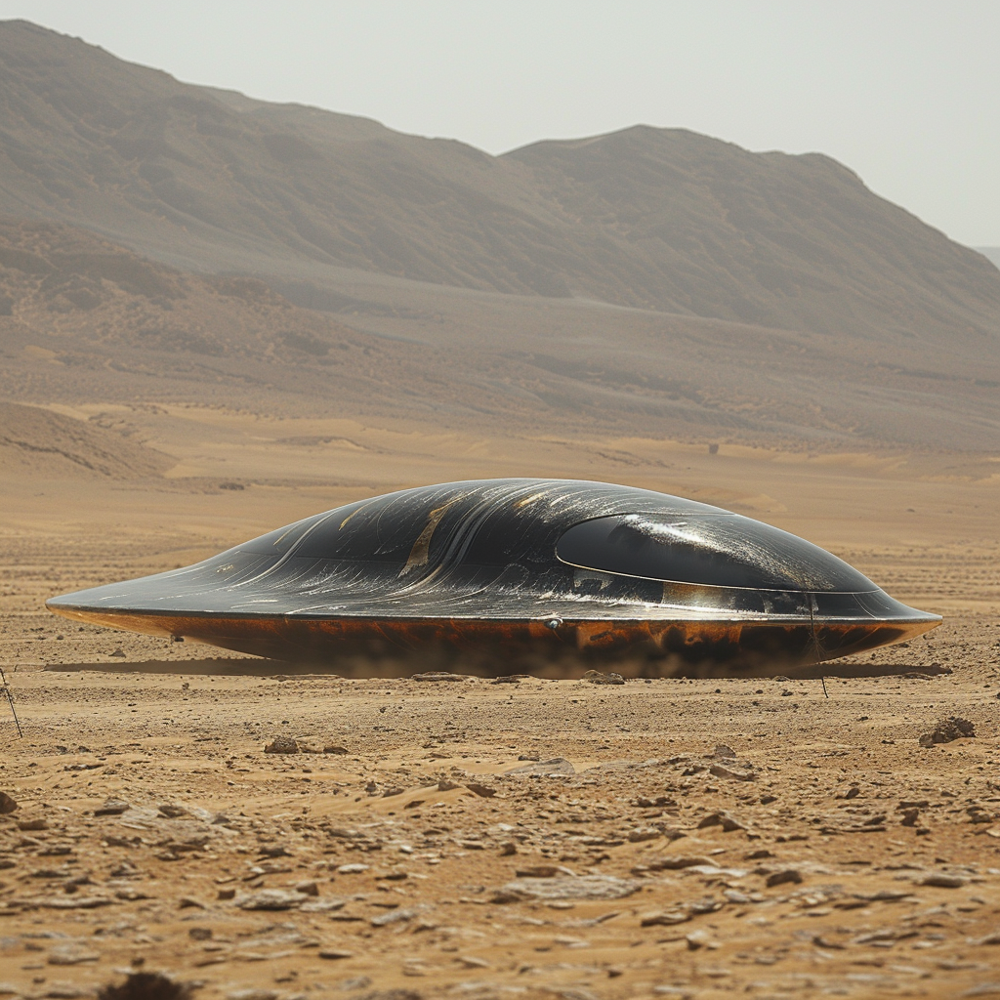

### A detailed guide on using 10zebra's AI-powered platform to realize my Spielberg-inspired sci-fi concept.

**Background and Inspiration:

**Raised in Los Angeles, the heart of movie magic, I fell in love with storytelling. My fascination grew when I appeared on 'The Magic Happening,' a show on Beverly Hills' Public Access Channel during my teenage years. Even after moving to Northern California at 17, my passion for film remained unshaken. My journey in filmmaking even led to a consulting role on DreamworksTV's "Junk Drawer Magic," connecting me to the industry Spielberg helped pioneer. 

A year ago on 'The Late Show with Stephen Colbert,' Spielberg shared a thought-provoking concept that has since become the inspiration for my own sci-fi movie pitch. He mused about the possibility that UFOs might be piloted by 'future anthropologists' — evolved humans from our distant future studying their own past. This idea immediately captured my imagination, compelling me to explore its potential in a science fiction narrative. Just yesterday, it was confirmed that Spielberg will indeed direct a movie involving aliens, although specific plot details remain undisclosed. The world of science fiction is buzzing with excitement over this news.

<iframe class="w-full h-full" src="https://www.youtube.com/embed/ZgUed2YirEk" title="YouTube video player" frameborder="0" allow="accelerometer; autoplay; clipboard-write; encrypted-media; gyroscope; picture-in-picture; web-share" allowfullscreen></iframe>

Using **10zebra**, an innovative AI-powered storyboarding platform, I've created an 18-scene storyboard titled "Future Anthropologists." The story follows a team of scientists and military personnel as they encounter a group of evolved humans from the distant future who have traveled back in time to study and document the pivotal moments that led to their own era. However, their presence inadvertently sets in motion a chain of events that could alter the course of history, and the protagonist, a brilliant anthropologist, must navigate a web of political intrigue and personal sacrifice to prevent a catastrophic future event and ensure the survival of humanity.

For my take on Spielberg's "future anthropologists" concept, I've created an 18-scene storyboard that captures the essence of the story and its key moments. Here's a breakdown of each scene:

- ***In a futuristic living room, two children watch the classic movie "E.T.," marveling at the old-fashioned special effects.***
- ***A sleek, metallic UFO appears in the night sky above a bustling city, causing widespread panic and confusion.***
- ***Inside a high-tech government facility, a team of scientists and military personnel scramble to analyze the UFO's trajectory and intentions.***
- ***The UFO lands in a remote desert location, and a group of tall, slender beings with translucent skin emerges from the craft.***
- ***The beings are revealed to be humans from the distant future, having evolved over millennia.***
- ***In a flashback, we see the future Earth on the brink of ecological collapse, with the remaining humans forced to flee to the stars.***
- ***The future anthropologists explain their mission: to study and document the pivotal moments in Earth's history that led to their own time.***
- ***The team of scientists and the future anthropologists form an uneasy alliance as they work to uncover the secrets of the past.***
- ***Tensions rise as government officials seek to weaponize the knowledge gained from the future anthropologists.***
- ***The protagonist, a brilliant anthropologist, makes a startling discovery about the true purpose of the mission.***
- ***In a race against time, the protagonist must navigate a web of political intrigue and betrayal to prevent a catastrophic future event.***
- ***The future anthropologists reveal the impending disaster that will reshape the course of human history.***
- ***The protagonist and their allies devise a plan to alter the past and save the future.***
- ***In a thrilling chase sequence, the protagonist must evade government agents and saboteurs to carry out their mission.***
- ***The future anthropologists prepare to return to their own time, entrusting the protagonist with the knowledge to change the course of history.***
- ***The protagonist faces a moral dilemma, weighing the consequences of altering the past against the potential for a better future.***
- ***In a climactic showdown, the protagonist must confront the forces seeking to maintain the status quo and bring about the predicted catastrophe.***
- ***The story concludes with a glimpse of a new, more hopeful future, shaped by the actions of the protagonist and the wisdom of the future anthropologists.***

With 10zebra's intuitive interface and AI-assisted tools, I was able to quickly visualize key scenes and sequences, from the initial appearance of the futuristic UFO to the climactic showdown that determines the fate of the world. The platform's ability to democratize the creative process is truly remarkable, allowing aspiring filmmakers and storytellers to bring their movie ideas to life through interactive, visually compelling storyboards, regardless of their background or experience.

### 18 Panel Storyboard for "Future Anthropologists"

Storyboard Overview: Presented here is the visual journey of &#x27;Future Anthropologists,&#x27; a narrative crafted with 10zebra. This storyboard follows key moments from a story that spans across time, from the curiosity of children to the insights of evolved humans. Each scene is carefully depicted to explore the pivotal interactions and discoveries that could reshape the future.

10zebra offers both text-to-video and video-to-video rendering capabilities, which are great for quick video outputs. For the fourth sequence, I decided to take a mixed approach to enrich the visual storytelling. I used Midjourney for initial image generation, capturing the essence of a UFO landing in the desert.

Then, I worked with RunwayML to animate the visual, combining techniques to produce a compelling representation for this sequence in my storyboard:

<iframe class="w-full h-full" src="https://player.vimeo.com/video/936229671" frameborder="0" allowfullscreen></iframe>

This combination was also applied to a few other sequences, leveraging the strengths of each tool to bring the story to life.

Here is the completed sequence of my storyboard, which brings to life the Spielberg-inspired narrative of 'Future Anthropologists.' Each frame captures a critical moment in the unfolding drama, from the early scenes of childlike wonder to the climactic decisions that hold the potential to alter humanity's path. This final cut strings together scenes of suspense, alliance, and foresight, showcasing a journey of characters grappling with their history and the future they will shape.

<iframe class="w-full h-full" src="https://player.vimeo.com/video/936241589" frameborder="0" allowfullscreen></iframe>

As I keep refining the "Future Anthropologists" storyboard, I'm excited about what Spielberg's upcoming alien movie could mean for sci-fi fans and storytellers. Drawing inspiration from his ideas has sparked a narrative that now has a life of its own, thanks to the innovative tools at 10zebra.

At this stage, I'm opening up the project for collaboration. I'm looking for fresh eyes and ideas to help expand the storylines, develop characters, and add new twists. Whether you’re a seasoned storyteller or a newcomer to sci-fi, your input is welcome. The storyboard is embedded below for anyone who wants to contribute to its growth.

<iframe class="w-full h-full" src="https://10zebra.app/p/11zBk438uJkG" frameborder="0" allowfullscreen></iframe>

With tools like 10zebra at our fingertips, the future of storytelling sparkles with potential. As we anticipate more details about Spielberg's alien movie, I encourage all science fiction enthusiasts and aspiring filmmakers to explore the possibilities AI-assisted storyboarding offers. Who knows? The stories we craft today might just inspire the next blockbuster, echoing the inventive spirit of Spielberg himself.

I’m truly excited to see how this community can come together to expand the "Future Anthropologists" universe. Whether you’re an avid sci-fi fan, a creative writer, or someone with a knack for visual storytelling, your insights and creativity are crucial. This is more than just a personal project, it's a collective adventure that thrives on diverse contributions. So dive in, share your ideas, and let's co-create a story that might one day light up the silver screen. Your vision could be the key to unlocking a new chapter in science fiction storytelling.

#### Join the adventure and see where your creativity can lead with 10zebra. Together, let's push the boundaries of what storytelling can achieve.

#10zebra #SpielbergAlienMovie #FutureAnthropologists #StoryboardingWithAI #MoviePitch #Storytelling #AICreativity #IndieFilmmaking #SciFiMovies #ColbertInspired

Try it out yourself: [10zebra.app](https://10zebra.app/)
