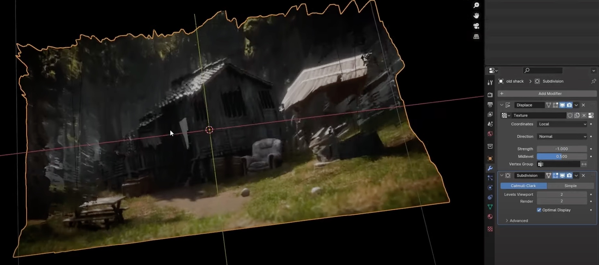
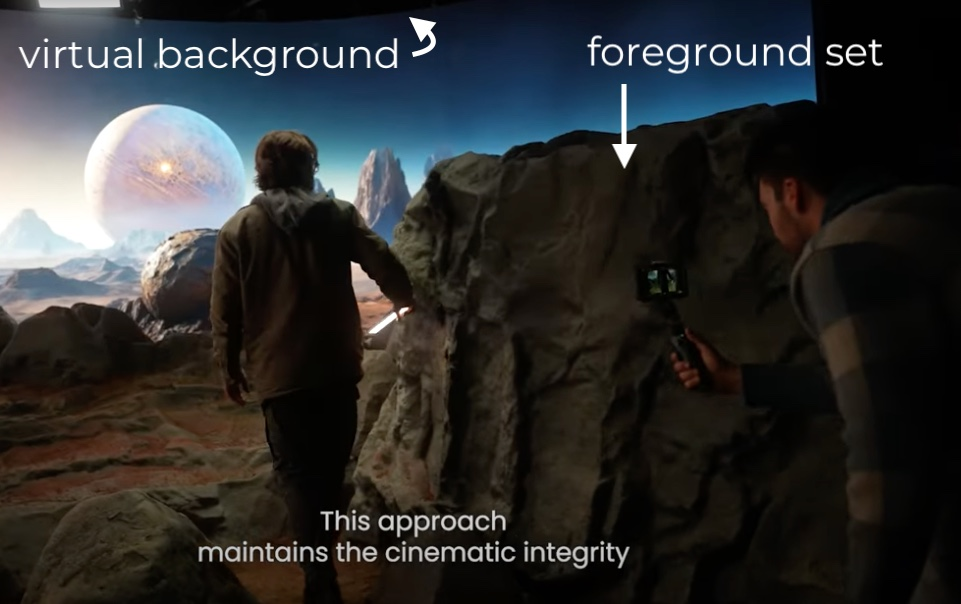
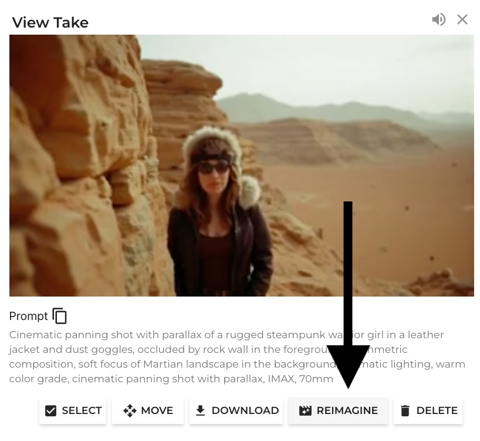
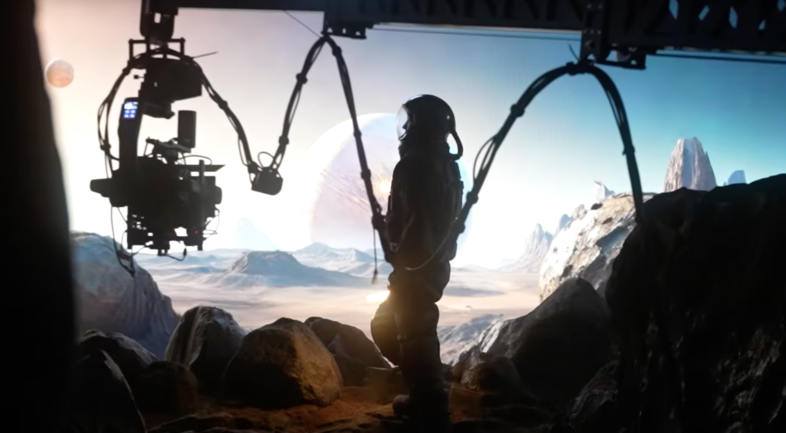
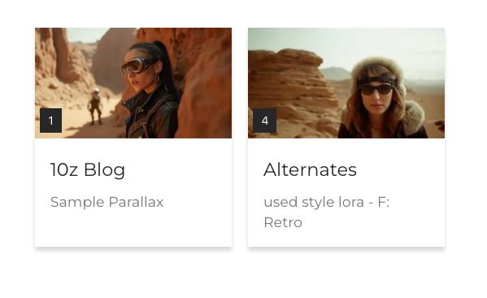

Sometimes you build the whole 3D model, and sometimes you build a "good enough" model for the background.

What you might ask, is a 2.5D model?

Here is a composite image from the video below.

By selecting and moving one layer you can &quot;fake&quot; the motion you would see from full 3D.

<iframe class="w-full h-full" src="https://www.youtube.com/embed/ZGWgkM9CrvM" title="YouTube video player" frameborder="0" allow="accelerometer; autoplay; clipboard-write; encrypted-media; gyroscope; picture-in-picture; web-share" allowfullscreen></iframe>

Ok, so not all of us have giant LED wall behind us. But isn't it interesting that our core assets - Images and depth maps, are remarkably accessible to generate and use (and reuse for a later production).

This explanation of virtual production process uses a still frame from the video above.

We will see this technology leveraged in a range of ways with and around generative AI video models. You can build them explicitly, and you can even benefit from them in your prompting.

So let's take them in order:

### Q1: How do I get cool 3D parallax using just text-to-video?

A: Make sure to include objects a three different depth planes. For example include your character, but also say "**soft focus of Martian landscape in the background, dramatic lighting, warm color grade**" for the background, and "***occluded by rock wall in the foreground***" and "**cinematic panning shot with parallax**" You can change the parts, but the components are: something in the background, something in foreground, and some words to describe camera motion that yields parallax, often including the word parallax, or panning motion left or right.

This technique is very fast. Its is good for establishing shots, concept pitches, pre-viz and mood boards. Its possible to use these assets in a production using just gen AI, but you should have a plan how to tackle character consistency if re-occurring characters are also in the same environment.

<iframe class="w-full h-full" src="https://player.vimeo.com/video/1014978985" frameborder="0" allowfullscreen></iframe>

Here is the prompt used for the shot above:

**Cinematic panning shot with parallax of a rugged steampunk warrior girl in a leather jacket and dust goggles, occluded by rock wall in the foreground, asymmetric composition, soft focus of Martian landscape in the background, dramatic lighting, warm color grade, cinematic panning shot with parallax, IMAX, 70mm**

This was generated on 10zebras platform this morning. (That's October 1st to all you blog readers who don't subscribe). Its worth pointing out, because even if our prompt stratgey may be simiilar, the underlying video models get better over time, with better temporal coherence, and character consistency.

A short note about depiction of women in genAI. Please make an effort to avoid generic characters stuck on societal bias. Try another ethnicity? Use a complex emotion? Fight aesthetic bias with "candid portrait" and "raw footage." Ok, diatribe over.

Sometimes you fail to get the motion you want, but like the composition. [It is still a genAI model, based on lots of internal noise] In case you want to save the composition, use the "reimagine" button, and simplify your previous prompt. Try including just the camera motion like "pan right."

Some of you might we wondering "why not just cut to the chase and give the sample prompt. Why all the 2.5D hacks?" Two reasons. First, I think if you reason about the fundamentals, you can write better prompts and understand why they work and fail. Second, the technical language used by experts gets deeply entwined with how we can prompt to get specific effects. Anyone use :*volumetric lighting:*in thier prompts? Adding a "70mm" still impacts generation, even though their is no actual lens in the diffusion model. So, you will have a much better chance of discovering meaningful prompt improvements by thinking about whats actually gets onto a 2D projection of a camera sensor, human eyeball or virtual camera, and how it gets discussed in production.

#### Q2: How do I make assets to create the 2D depth planes?

Start with image prompting. Midjourney (closed model) and Flux (open model) are two of your best options at the time of this writing. Try prompting for landscapes isolated from their background, either white or green screen. Yep, you can prompt for a green screen background. This make your comping that much easier. AI roto tools exist. But life is easier, if you start with a prompt the yields easy to modify assets (Think: if you wanna chorma key it). On the other hand, if one image from Midjourney already has all the depth planes you want, you can consider a blender workflow:

Blender is awesome (though sometimes intimidating for noobs, but you can learn it!). Check out this video by baeac:

<iframe class="w-full h-full" src="https://www.youtube.com/embed/bApppAYJu-8" title="YouTube video player" frameborder="0" allow="accelerometer; autoplay; clipboard-write; encrypted-media; gyroscope; picture-in-picture; web-share" allowfullscreen></iframe>

Summarizing the approach above. A strength of -1 lets the intensity map onto depth correctly.

The core idea is to use the depth map of a single image to displace the pixels. The fact that this works is similar to why Gaussian splatting works: floating pixels located in 3 space will displace coherently with your camera motion. Of course this basic blender approach lacks all the fancy optimizations the neural nets employ for splatting - all the size color orientation and intensity of each "point" are not adjusted by Blender to be angularly dependent - just the relative position.

And there is a lot of noise in depth maps. If only we has AI to separate each pixel into a grouped plane, and then have control over the relative depth ;)

Enter software that does just that.

#### Q3: How do I get my depth assets projected onto a screen, informed of camera position, for virtual production?

If you have the LED wall (or maybe just want to try something ambitious with a big smart screen TV?), then checkout Cuebric with [Disguise](https://www.disguise.one/en/cuebric-partnership). Let us know what you make and we will post it on our socials, and include tips for other creators here. Super kudos if you work genAI video output into your environment -- by propagating the depth map (likely from a still frame) to the video data generated from 10zebra.  The first person to do this, I'll personally buy you a pulled pork sando at the next SIGRAPH, lol.

Cuebric actually has a new user starter plan with 3 projects that supports up to 15 layers. Try it: [here](https://app.cuebric.com/auth/register)

I wish I had a setup like this.

#### Tangent

Did you know that Vision scientist David Marr proposed that 2.5D processing is one of the stages of human [visual perception](https://en.wikipedia.org/wiki/David_Marr_(neuroscientist))? If thats really true about how the brain works, then it makes sense that hacking 2.5D models of generative media is a "good enough hack" to tricking our minds that a full 3D environment is there.

This is especially true for a film scene when our eyes are drawn to the high resolution pixels of the main character. The "mostly correct" environment provides a motion field to embed our viewpoint with respect to the main character. Sound familiar? Cinematographers have always had an incentive to make it real enough to trick the brain, but not so real that it breaks the budget.

#### If you don't have all the GEAR

Ok so you might not have an LED wall, a RED camera, tracking gear, or a fancy GPU, but you can still use 10zebra from a web browser. And don't scoff at AI previz assets. Just wait and see the kind of upscalers we will get in 2025. 😉

For an example testbed to generate parallax combined with environmental motion quickly on 10zebra, [you can fork this media](https://10zebra.app/p/YQh2_nztqmpd):

[https://10zebra.app/p/YQh2_nztqmpd](https://10zebra.app/p/YQh2_nztqmpd)

If you are working for a client, please generate content fresh in your own project, with an appropriate license, respecting the IP holder's model preferences.
