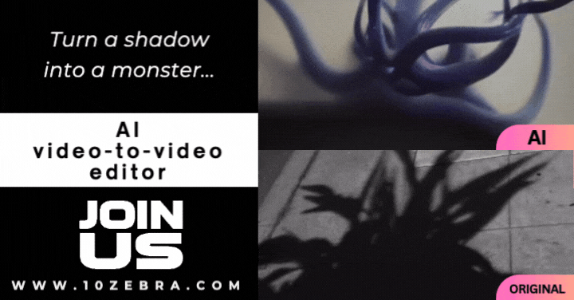

## AI Video-to-video Generation Transforms Imagination Into Creation

10zebra founder, Philip Meier, guides users through his process using the 10zebra platform. This walkthrough showcases 10zebra's innovative video-to-video feature that transforms imagination into creation.

### Watch the step-by-step process of how it was done on 10zebra.

<iframe class="w-full h-full" src="//cdn.embedly.com/widgets/media.html?src=https%3A%2F%2Fwww.loom.com%2Fembed%2F52ccaee7141d43c985c5ddbf946f90ae&amp;display_name=Loom&amp;url=https%3A%2F%2Fwww.loom.com%2Fshare%2F52ccaee7141d43c985c5ddbf946f90ae&amp;image=https%3A%2F%2Fcdn.loom.com%2Fsessions%2Fthumbnails%2F52ccaee7141d43c985c5ddbf946f90ae-00001.gif&amp;key=c4e54deccf4d4ec997a64902e9a30300&amp;type=text%2Fhtml&amp;schema=loom" frameborder="0" allowfullscreen></iframe>

Try it out yourself: [10zebra.app](https://10zebra.app/)

<iframe class="w-full h-full" src="https://10zebra.dev/p/-0YmDtYxxg0z/hmdoLnNoxBxu6u-it8Nl9" frameborder="0" allowfullscreen></iframe>

